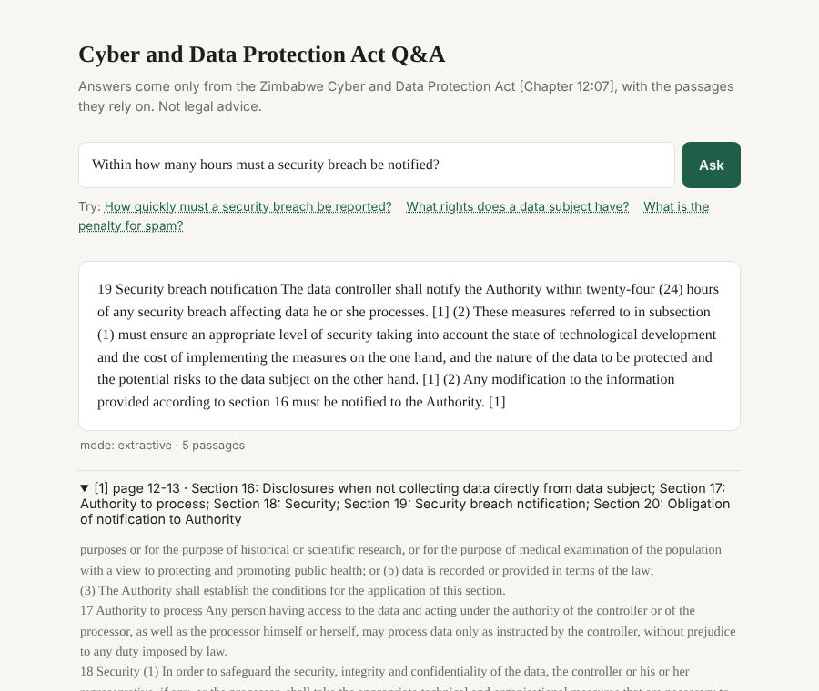

# Document Q&A Assistant (RAG)

[](https://github.com/Mcgini100/doc-qa-rag/actions/workflows/tests.yml)
[](https://render.com/deploy?repo=https://github.com/Mcgini100/doc-qa-rag)

A retrieval-augmented generation (RAG) API that answers questions about the **Zimbabwe Cyber and Data
Protection Act [Chapter 12:07] (Act No. 5 of 2021)**. Every answer cites the passages (page and section) it
came from, and the service replies **"not found in the documents"** instead of guessing when the Act does not
cover the question.



## How it works

```
PDF/HTML/TXT ──► clean ──► chunk (~600 tokens, 75 overlap, page + section metadata)
                                │
                 ┌──────────────┴──────────────┐
                 ▼                             ▼
     embeddings → FAISS (inner product)    BM25 keyword index
                 └──────────────┬──────────────┘
question ──► top-k by Reciprocal Rank Fusion ──► relevance gate ──► LLM answers ONLY from the
                                                   (refuse if       numbered passages, cites [n],
                                                    off-topic)      or says "not found in the documents"
```

* **Ingestion** (`app/ingest.py`): pypdf text extraction; removes running headers/footers and page numbers,
  joins hyphenated line breaks, drops the statute's "Arrangement of Sections" (table of contents) pages,
  tracks section headings (`Section 19: Security breach notification`), and packs paragraph-sized units into
  ~600-token chunks with ~75-token (12.5%) overlap. Chunks never lose their page numbers.
* **Embeddings** (`app/embeddings.py`): OpenAI `text-embedding-3-small` when `OPENAI_API_KEY` is set;
  otherwise WordLlama (256-d, weights bundled in the pip wheel), so the service, tests and CI run fully offline.
* **Retrieval** (`app/index.py`): FAISS exact search plus BM25, fused with Reciprocal Rank Fusion. Legal text
  is full of exact terms ("data controller", "level 11 fine") that keyword search catches.
* **Answering** (`app/qa.py`): GPT-4o-mini at temperature 0 with a prompt that allows only facts from the
  numbered passages and requires `[n]` citations. Without a key the API returns an extractive answer (the most
  relevant sentences, each cited).
* **API** (`app/main.py`, FastAPI + Pydantic): `POST /ask`, `POST /ingest` (PDF/TXT/MD/HTML upload, protected by
  `ADMIN_TOKEN`), `GET /health`, a demo page at `/`, OpenAPI docs at `/docs`. Rate limited with slowapi
  (10 questions/minute per IP by default).

## Evaluation

`eval/questions.jsonl` holds **20 questions**: 16 answerable from the Act (each with a reference answer, the
section, the page and a short verbatim **evidence** quote) and 4 that the Act cannot answer (licence fees,
the current minister, DPO salaries, 2023 breach statistics). The questions and reference answers were drafted
with AI assistance from the Act's text; every evidence quote is checked automatically against the PDF page it
cites.

* **Retrieval hit@k**: a question is a hit if any of the top-k chunks contains its evidence quote.
* **Answer correctness**, two judges reported separately:
  * *key-fact match* (automatic): each required fact (e.g. "level 11" and "seven years") must appear in the
    answer; unanswerable questions count as correct only when the system refuses;
  * *LLM judge* (`--judge`): GPT-4o-mini compares the answer with the reference answer.

### Results: local embeddings, no LLM (reproducible offline, runs in CI)

`python -m eval.run_eval` → [`eval/results_local_extractive.json`](eval/results_local_extractive.json)

| Retrieval (16 answerable) | hit@1 | hit@3 | hit@5 |
|---|---|---|---|
| BM25 only | 0.81 | 0.94 | 1.00 |
| WordLlama dense only | 0.62 | 0.69 | 0.81 |
| **Hybrid (RRF)**, used by the API | 0.75 | 0.94 | 1.00 |

| Answers (extractive mode, top-5) | Result |
|---|---|
| Key-fact correct, answerable | 12 / 16 (75%) |
| Correct refusals, unanswerable | 0 / 4 |

What fails, honestly:

* **No refusals in offline mode.** The four unanswerable questions are on-topic (they mention data
  controllers, ministers, data protection officers), so retrieval finds related passages and the
  extractive fallback quotes them. The relevance gate only stops clearly off-topic questions
  (e.g. football); refusing on-topic-but-unanswerable questions needs the LLM step.
* **Extractive answers miss multi-part facts or pick the wrong sentences**: the spam penalty ("level 5 ...
  one year") sits after the sentence that matches the question; the electronic-evidence and data-quality
  answers stop before listing all criteria; and "What rights does a data subject have?" quotes section 27
  (incapacitated data subjects) instead of section 14, although section 14 is retrieved.
* **Hybrid hit@1 is below BM25 alone**: the 256-d WordLlama model is weak on legal language, so fusing it in
  pushes some correct chunks from rank 1 to rank 2-3. Recall at 3 and 5 is unchanged.

### Results: OpenAI embeddings + GPT-4o-mini

Needs a paid key, so it is not run in CI. To measure (costs well under US$0.05):

```bash
export OPENAI_API_KEY=sk-...
python scripts/build_index.py          # embeds the 35 chunks with text-embedding-3-small
python -m eval.run_eval --judge --out eval/results_openai.json
```

The script prints the same retrieval table plus key-fact and LLM-judge correctness and the refusal rate.

## Run it

```bash
pip install -r requirements.txt -r requirements-dev.txt
cp .env.example .env                    # optional: add OPENAI_API_KEY
uvicorn app.main:app --reload           # http://localhost:8000 (demo) and /docs
pytest -q                               # 33 tests: chunking, retrieval, refusal, API, rate limit, ingest
```

```bash
curl -X POST localhost:8000/ask -H 'Content-Type: application/json' \
     -d '{"question": "Within how many hours must a security breach be notified?"}'
```

Response (shortened):

```json
{"question": "...", "answer": "... within twenty-four (24) hours ... [1]", "found": true, "mode": "extractive",
 "citations": [{"n": 1, "doc": "Cyber_and_Data_Protection_Act_Cap_12-07_No_5_of_2021.pdf", "pages": "12-13",
                "sections": ["Section 18: Security", "Section 19: Security breach notification", "..."], "text": "..."}]}
```

**Docker:** `docker build -t doc-qa-rag . && docker run -p 8000:8000 -e OPENAI_API_KEY=$OPENAI_API_KEY doc-qa-rag`.
The image pre-builds the offline index; with a key, the OpenAI index is built on first start and cached.

**Deploy:** `render.yaml` is a Render Blueprint (free plan, Docker, `/health` check, generated `ADMIN_TOKEN`;
set `OPENAI_API_KEY` in the dashboard). GitHub Actions runs the tests, the offline evaluation, and a Docker
build that starts the container and asks it a question.

## Configuration

| Variable | Default | Meaning |
|---|---|---|
| `OPENAI_API_KEY` | – | Enables OpenAI embeddings and LLM answers |
| `EMBEDDING_BACKEND` | `auto` | `openai`, `local`, or `auto` (OpenAI if a key is set) |
| `OPENAI_CHAT_MODEL` | `gpt-4o-mini` | Answer model |
| `TOP_K` | `5` | Passages given to the model |
| `CHUNK_TOKENS` / `CHUNK_OVERLAP` | `600` / `75` | Chunk size and overlap (word-level tokens, about 1.1-1.3 OpenAI tokens each) |
| `RATE_LIMIT_ASK` / `RATE_LIMIT_INGEST` | `10/minute` / `3/minute` | Per-IP limits |
| `ADMIN_TOKEN` | – | Required as `X-Admin-Token` for `POST /ingest` when set |

## Source document

`data/docs/Cyber_and_Data_Protection_Act_Cap_12-07_No_5_of_2021.pdf`: the Act as gazetted on 11 March 2022,
distributed for free public access by [Veritas Zimbabwe](https://www.veritaszim.net). Also published on
[ZimLII](https://zimlii.org/akn/zw/act/2021/5/eng@2022-03-11). This project is a technical demonstration and
does not give legal advice.

## Limitations

* One document; questions that need several Acts (e.g. the Postal and Telecommunications Act) are out of scope.
* Section labels come from a heading regex; text quoted from other Acts in the consequential amendments
  (sections 35-37) is labelled with the amended Act's section numbers.
* The refusal threshold for the local embedder was set on six dev questions that are not in the evaluation set;
  the OpenAI threshold is a deliberately low guard, and the LLM does the fine-grained refusal.
